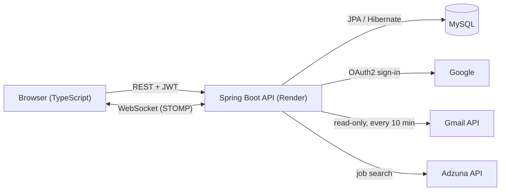

# Job Tracker

A real-time job application tracker. Sign in with Google, track applications on a drag-and-drop board, and let the app **read job emails from Gmail** (read-only) to move cards automatically when an interview invite, rejection or offer arrives. Every change is **pushed live over WebSockets** to every device that's signed in.

**Live demo:** `https://<your-app>.vercel.app` · **API docs:** `https://<your-api>.onrender.com/swagger-ui.html`

## Features

- **Google sign-in** (OAuth2), then a stateless **JWT** for every API call
- **Board** with five columns (Saved, Applied, Interview, Offer, Rejected) and drag-and-drop
- **Gmail status detection**: a rule-based classifier reads the sender, subject and preview of job emails and works out the company and status
  - High confidence: the board updates on its own, plus a live notification
  - Low confidence: the email goes to **Needs review** for a one-click confirm
  - Emails never move a card backwards (an old "application received" can't undo "Interview")
- **Real-time sync**: STOMP over WebSocket; open the app on a phone and a laptop and both update instantly
- **Reminders**: interviews in the next 24 hours, and a "follow up" nudge after 14 days with no reply
- **Find jobs**: live listings from the Adzuna API, scored against your skills (Java ≠ JavaScript), with a fresher-friendly filter and "Save to tracker"
- **Dashboard**: totals, response rate, applications per week, upcoming interviews, live activity feed

## Tech stack

| Layer | Technology |
|---|---|
| Backend | Java 17, Spring Boot 3, Spring MVC, Spring Security (OAuth2 client + resource server), Spring Data JPA, Hibernate, Spring WebSocket (STOMP), Spring Scheduling |
| Database | MySQL (production, Aiven free tier); PostgreSQL and Oracle also supported through Spring profiles; H2 (local) |
| API | RESTful JSON APIs, Bean Validation, global error handling, Swagger / OpenAPI |
| Frontend | TypeScript, HTML, CSS (no framework), Vite, `@stomp/stompjs` |
| Integrations | Google OAuth2, Gmail REST API, Adzuna Jobs API |
| Testing | JUnit 5, Spring Boot Test, MockMvc, Spring Security Test (18 tests) |
| Tooling | Maven, Git, Docker, Postman |
| Hosting | Render (backend, Docker), Vercel (frontend) |

## Architecture



**Sign-in flow:** the browser goes to `/oauth2/authorization/google` on the backend, Google redirects back, the backend creates or updates the user and redirects to the frontend with its own JWT in the URL fragment (`#/auth?token=...`). The frontend stores it and sends it as `Authorization: Bearer`. The WebSocket sends the same token in the STOMP `CONNECT` frame.

**Gmail flow:** "Connect Gmail" is a second OAuth2 registration (`google-gmail`) with the `gmail.readonly` scope and `access_type=offline`. The refresh token is stored **AES-GCM encrypted**. A scheduled job (and the "Sync now" button) searches Gmail for job-related emails since the last sync, classifies them, updates the board and pushes events to `/user/queue/updates`. Only the sender, subject and detected result are saved, never the email body.

### Project layout

```
backend/   Spring Boot API (package-by-feature)
  config/        security, JWT, WebSocket, OAuth2 success handler, AES token cipher
  application/   job applications: entity, repository, service, REST controller, DTOs
  gmail/         Gmail client, email classifier, sync service, "needs review" API
  jobs/          Adzuna search + skill matcher
  dashboard/     stats endpoint
  reminder/      scheduled interview and follow-up reminders
  realtime/      WebSocket push service
frontend/  TypeScript single-page app
  src/pages/     dashboard, board, jobs, emails, settings, login
  src/live.ts    WebSocket client with auto-reconnect
  src/dom.ts     small DOM helper (text is never injected as HTML, so it's XSS-safe)
render.yaml  Render blueprint for the backend
```

## Run locally

Needs Java 17 and Node 18+.

1. **Google OAuth client** (needed for sign-in; see [Google Cloud setup](#google-cloud-setup)). Add `http://localhost:8080/login/oauth2/code/google` and `http://localhost:8080/login/oauth2/code/google-gmail` as redirect URIs.
2. **Backend** (uses an H2 file database, no setup needed):
   ```bash
   cd backend
   export GOOGLE_CLIENT_ID=...  GOOGLE_CLIENT_SECRET=...
   ./mvnw spring-boot:run
   ```
   API at http://localhost:8080, Swagger at http://localhost:8080/swagger-ui.html
3. **Frontend**:
   ```bash
   cd frontend
   cp .env.example .env
   npm install
   npm run dev
   ```
   Open http://localhost:5173
4. **Tests**: `cd backend && ./mvnw test`

On Windows PowerShell, set variables with `$env:GOOGLE_CLIENT_ID="..."` and run `.\mvnw.cmd spring-boot:run`.

## Google Cloud setup

1. Go to https://console.cloud.google.com and create a project (for example "job-tracker").
2. **APIs & Services > Library**: enable the **Gmail API**.
3. **APIs & Services > OAuth consent screen** (Google Auth Platform):
   - User type **External**, app name "Job Tracker", your email as support and developer contact
   - Scopes: `openid`, `email`, `profile`, `.../auth/gmail.readonly`
   - Keep the app in **Testing** and add yourself (and anyone who will try it) under **Test users**. Gmail is a restricted scope; Testing mode allows up to 100 test users without Google's verification review. Recruiters you demo to can still sign in, but they'll need to be added as test users to connect Gmail.
4. **APIs & Services > Credentials > Create credentials > OAuth client ID**, type **Web application**:
   - Authorized redirect URIs:
     - `http://localhost:8080/login/oauth2/code/google`
     - `http://localhost:8080/login/oauth2/code/google-gmail`
     - `https://<your-api>.onrender.com/login/oauth2/code/google`
     - `https://<your-api>.onrender.com/login/oauth2/code/google-gmail`
   - Copy the **Client ID** and **Client secret**.

## Deploy

### 1. Database: Aiven MySQL (free, no card)

1. Sign up at https://console.aiven.io (Google or GitHub sign-in works).
2. **Create service** → **MySQL** → plan **Free** → pick a region close to Render's (for example Singapore) → name it `job-tracker-db` → **Create**.
3. Wait until the status is **Running**, then open the service **Overview** and copy **Host**, **Port**, **User** and **Password**.
4. Set the Render variables:
   - `DB_URL` = `jdbc:mysql://<host>:<port>/defaultdb?sslMode=REQUIRED`
   - `DB_USERNAME` = the user (usually `avnadmin`)
   - `DB_PASSWORD` = the password

Hibernate creates the tables on first start (`ddl-auto: update`).

**Other databases:** the same code runs on PostgreSQL (set `SPRING_PROFILES_ACTIVE=postgres` and `DB_URL=jdbc:postgresql://<host>:<port>/defaultdb?sslmode=require`) or Oracle (see below, `SPRING_PROFILES_ACTIVE=oracle`).

<details>
<summary>Oracle Autonomous Database setup</summary>

1. Create a free account at https://cloud.oracle.com (a card is asked for verification; Always Free resources aren't charged).
2. **Oracle Database > Autonomous Database > Create**: workload **Transaction Processing**, toggle **Always Free**, set an ADMIN password.
3. **Network access**: choose **Secure access from allowed IPs and VCNs only** and add Render's outbound IP addresses (Render dashboard > your service > **Connect > Outbound**). Then set **Mutual TLS (mTLS) authentication** to **Not required**, so the app can connect with TLS and no wallet file.
4. **Database connection**: choose **TLS** and copy the `..._low` connection string. Your `DB_URL` is `jdbc:oracle:thin:@` followed by that string.
5. Optional but recommended: create an app user instead of using ADMIN:
   ```sql
   CREATE USER jobtracker IDENTIFIED BY "<strong password>";
   GRANT CREATE SESSION, CREATE TABLE, CREATE SEQUENCE TO jobtracker;
   ALTER USER jobtracker QUOTA 200M ON DATA;
   ```
   Hibernate creates the tables on first start (`ddl-auto: update`).

</details>

### 2. Backend on Render

1. Push this repo to GitHub.
2. Render dashboard: **New > Blueprint**, pick the repo. It reads `render.yaml`.
3. Fill in the values it asks for:

   | Variable | Value |
   |---|---|
   | `FRONTEND_URL` | `https://<your-app>.vercel.app` (no trailing slash) |
   | `GOOGLE_CLIENT_ID` / `GOOGLE_CLIENT_SECRET` | from Google Cloud |
   | `DB_URL` / `DB_USERNAME` / `DB_PASSWORD` | from Aiven (see step 1) |
   | `ADZUNA_APP_ID` / `ADZUNA_APP_KEY` | free key from https://developer.adzuna.com (optional; without it "Find jobs" shows a setup message) |

   `JWT_SECRET` and `ENCRYPTION_KEY` are generated automatically.
4. After the first deploy, note the URL (for example `https://job-tracker-api.onrender.com`) and add its two redirect URIs in Google Cloud.

### 3. Frontend on Vercel

1. Vercel dashboard: **Add New > Project**, import the repo.
2. **Root Directory**: `frontend` (Vercel detects Vite).
3. **Environment variable**: `VITE_API_URL` = your Render URL.
4. Deploy. Then make sure Render's `FRONTEND_URL` matches the Vercel URL exactly.

## API

| Method | Path | Purpose |
|---|---|---|
| GET | `/api/me` | Profile, skills, Gmail status |
| PUT | `/api/me/skills` | Update skills used for job matching |
| GET / POST | `/api/applications` | List (filter `status`, search `q`) / create |
| GET / PUT / DELETE | `/api/applications/{id}` | Read / update / delete |
| PATCH | `/api/applications/{id}/status` | Change status (drag-and-drop) |
| GET | `/api/dashboard` | Stats, weekly chart, interviews, activity |
| GET | `/api/gmail/status` | Gmail connection state |
| POST | `/api/gmail/sync` | Sync now |
| DELETE | `/api/gmail` | Disconnect Gmail (revokes Google access) |
| GET | `/api/gmail/emails?view=review\|all` | Detected job emails |
| POST | `/api/gmail/emails/{id}/accept` / `dismiss` | Confirm or dismiss a "needs review" email |
| GET | `/api/jobs/search?what=&where=&page=` | Job search with skill match score |
| WS | `/ws` → subscribe `/user/queue/updates` | Live events |

Full interactive docs at `/swagger-ui.html`.

## Security notes

- Every query is scoped by the signed-in user's id, so one user can never read or change another's data (covered by a test).
- Gmail refresh tokens are encrypted at rest with AES-GCM; disconnecting revokes them at Google.
- The JWT travels in the URL fragment once (never sent to servers), then is removed from the URL and history.
- Job links are only rendered if they're `http(s)`, and all text is inserted as text nodes, never HTML.
- CORS and WebSocket origins are locked to `FRONTEND_URL`.

## Known limits (and why)

- **Render free tier sleeps after about 15 minutes idle.** The first request takes 30–60 seconds, and Gmail is only checked while the server is awake. Emails that arrive while it's asleep are picked up on the next sync, so nothing is lost. A paid instance or an uptime pinger removes the delay.
- **Single service instead of microservices.** Splitting auth, applications and Gmail into separate services would mean three sleeping free-tier instances and a message broker. The code is organised by feature, so each package could become its own service with a gateway if needed.
- **Rule-based email classifier.** It's predictable and easy to test. Unsure cases go to "Needs review" instead of guessing.
- **Push vs. polling for Gmail.** Gmail push notifications need Google Cloud Pub/Sub and a public webhook; polling every 10 minutes is simpler and fits the free tier.
